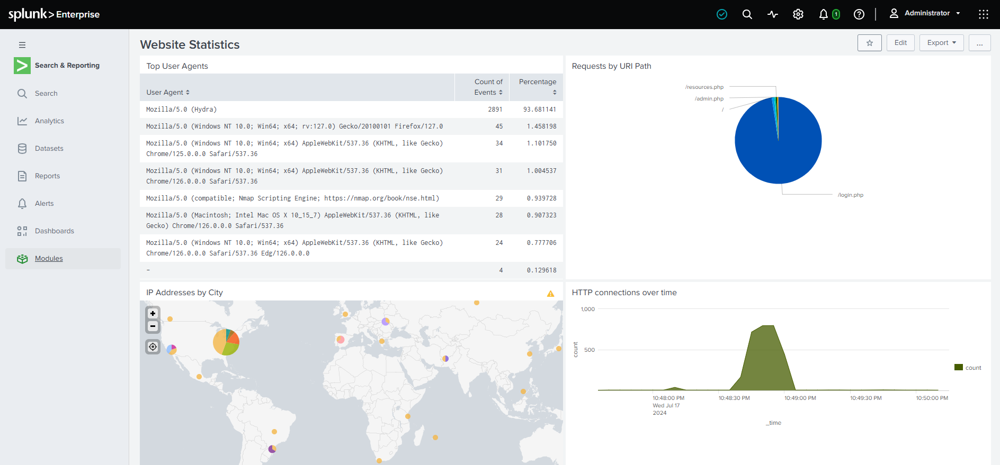
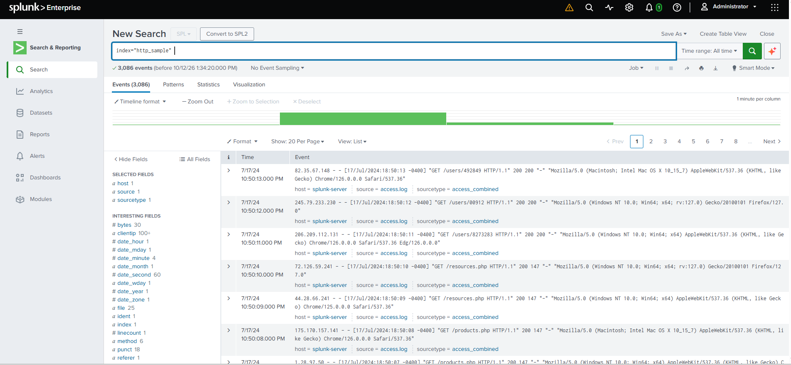
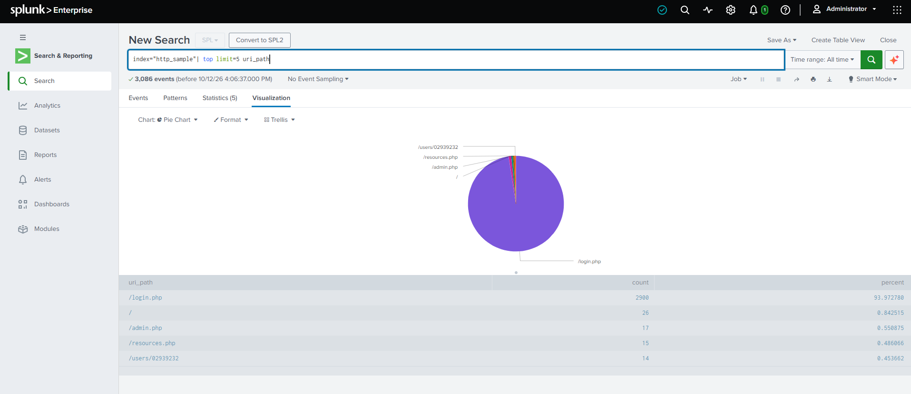
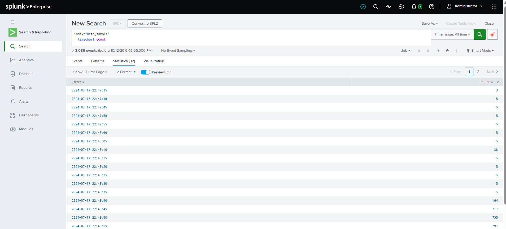
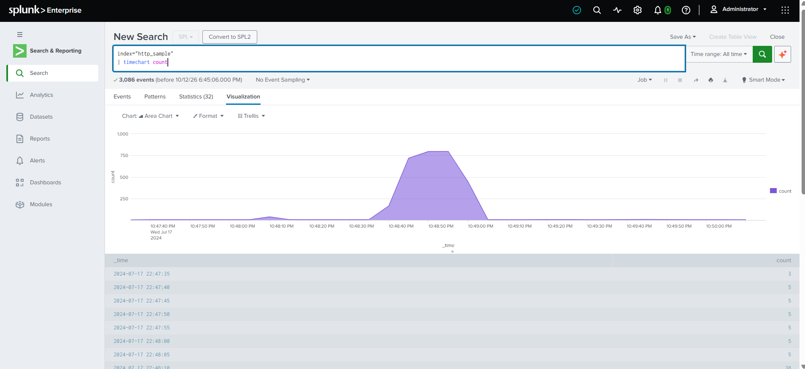
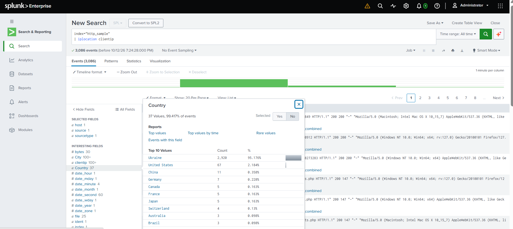
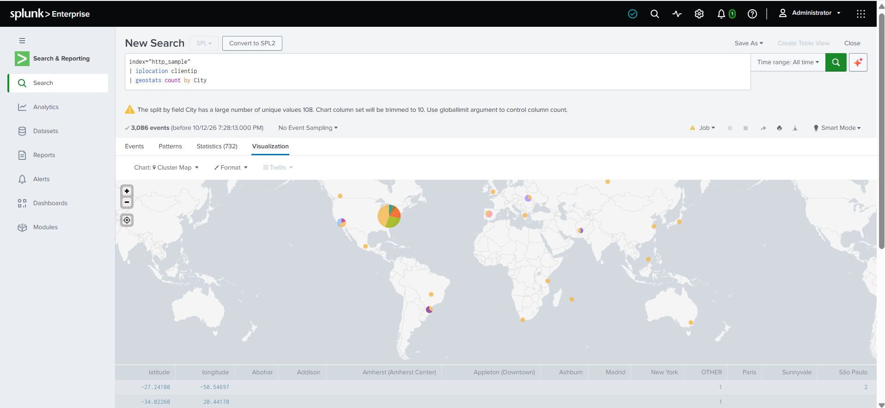
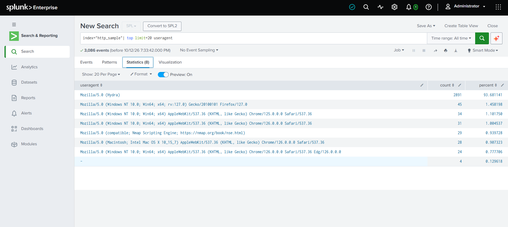

# SOC Monitoring Dashboard — Website Statistics

## Overview

This project builds a four-panel Splunk dashboard, **Website Statistics**, that summarizes web-server activity from an imported Apache-style access log. Each panel answers a question a SOC analyst asks when monitoring a web server: *what is being requested, when is traffic abnormal, where is it coming from, and what is making the requests?*

> **Data note:** Unlike Projects 01–03, this dashboard is built on an **imported sample access log**, not telemetry generated in this lab. The attack traffic the dashboard surfaces (see [What the Dashboard Shows](#what-the-dashboard-shows)) comes from that dataset.



---

## Objectives

- Ingest a web-server access log into Splunk and validate it.
- Build panels that summarize requested resources, traffic volume over time, client geography, and client software.
- Combine the panels into one dashboard that surfaces anomalies against a traffic baseline.
- Document what each panel reveals and how it supports monitoring and detection.

---

## Data Source

| Item | Value |
|---|---|
| Log file | `access.log` (imported into Splunk Enterprise) |
| Index | `http_sample` |
| Sourcetype | `access_combined` |
| Host | `splunk-server` |
| Events | 3,086 |
| Event window | 17 Jul 2024, 22:47:37 – 22:50:13 UTC (`18:47:37 – 18:50:13 -0400` in the raw log) |

Splunk displays timestamps in UTC, so a raw `-0400` entry at `18:50:13` appears as `10:50:13 PM`.

### 1. Validating the data

The index was searched first to confirm the events were ingested and the fields were extracted (`clientip`, `method`, `uri_path`, `useragent`, `bytes`).

```spl
index="http_sample"
```



---

## Panel 1 — Requests by URI Path (pie chart)

**Question answered:** which paths on the web server are being accessed, requested, or posted to?

```spl
index="http_sample"
| top limit=5 uri_path
```

The `top` command counts each `uri_path` value and returns the five most frequent with their share of all events. The result was displayed as a pie chart and saved to the dashboard as **Requests by URI Path**.



| uri_path | Count | Percent |
|---|---|---|
| `/login.php` | 2,900 | 93.97% |
| `/` | 26 | 0.84% |
| `/admin.php` | 17 | 0.55% |
| `/resources.php` | 15 | 0.49% |
| `/users/02939232` | 14 | 0.45% |

**Analyst value:** a single login endpoint receiving about 94% of all requests is far outside what normal browsing looks like. Repeated hits against an authentication page are a standard sign of credential guessing.

---

## Panel 2 — HTTP Connections over Time (area chart)

**Question answered:** how does request volume change over time, and when does it deviate from the baseline?

```spl
index="http_sample"
| timechart count
```

`timechart count` buckets the events by time and counts the records in each bucket. Here Splunk chose 5-second buckets, giving 32 rows over the roughly 2½-minute log. The result was displayed as an area chart and saved as **HTTP connections over time**.





| Window (UTC) | Events per 5 s | Reading |
|---|---|---|
| 22:47:35 – 22:48:05 | 3–5 | Baseline |
| 22:48:10 | 38 | Small burst |
| 22:48:15 – 22:48:35 | 5 | Baseline |
| 22:48:40 | 164 | Ramp-up |
| 22:48:45 – 22:48:55 | 717 / 795 / 797 | Sustained peak |
| 22:49:00 onward | tapering off, then about 5 | Return to baseline |

**Analyst value:** the baseline is steady at about 5 events per 5 seconds, so the peak of 797 is roughly 160 times normal. This kind of panel suits resource monitoring and app-usage tracking, and in a security context it flags bursts that break from the baseline. Digging into a burst can uncover brute-force attacks, scans, or denial-of-service activity.

---

## Panel 3 — IP Addresses by City (cluster map)

**Question answered:** where in the world are the clients connecting from?

```spl
index="http_sample"
| iplocation clientip
| geostats count by City
```

`iplocation` enriches each event with location fields (`City`, `Country`, `lat`, `lon`) looked up from the client IP. `geostats` then aggregates the counts by city and plots them on a world map. The result was saved as **IP Addresses by City**.

Enrichment added the location fields, including `Country`, which resolved for 99.4% of events:





| Country | Events | Percent |
|---|---|---|
| Ukraine | 2,920 | 95.18% |
| United States | 67 | 2.18% |
| China | 11 | 0.36% |
| Germany | 7 | 0.23% |

**Analyst value:** geographic concentration is a fast triage signal. Almost all traffic resolving to one country, in a dataset where legitimate visitors are scattered worldwide, points to a single dominant source worth investigating.

---

## Panel 4 — Top User Agents (table)

**Question answered:** what software is making the requests?

```spl
index="http_sample"
| top limit=20 useragent
| rename useragent as "User Agent", count as "Count of Events", percent as "Percentage"
```

The `top` command was run through the predefined *Top values* report on the `useragent` field. The `limit=20` setting returned all 8 distinct user agents. Because the table goes on a dashboard, `rename` was used to give the columns readable headers. The result was saved as **Top User Agents**.



| User Agent | Count of Events | Percentage |
|---|---|---|
| `Mozilla/5.0 (Hydra)` | 2,891 | 93.68% |
| Firefox 127 (Windows) | 45 | 1.46% |
| Chrome 125 (Windows) | 34 | 1.10% |
| Chrome 126 (Windows) | 31 | 1.00% |
| `Mozilla/5.0 (compatible; Nmap Scripting Engine; …)` | 29 | 0.94% |
| Chrome 126 (macOS) | 28 | 0.91% |
| Edge 126 (Windows) | 24 | 0.78% |
| `-` (empty) | 4 | 0.13% |

**Analyst value:** two of these user agents identify offensive tooling: **Hydra**, a password-guessing tool, and the **Nmap Scripting Engine**, a scanner. Real browsers make up the remaining few percent.

---

## What the Dashboard Shows

Read together, the four panels tell one story:

- **Panel 1** shows `/login.php` taking about 94% of requests.
- **Panel 4** shows the `Hydra` user agent at about 94% of events — the same proportion.
- **Panel 2** shows traffic jumping from a baseline of about 5 events per 5 seconds to about 800. About 2,900 events fall in the peak window, consistent with Hydra's 2,891 requests.
- **Panel 2** also shows a smaller burst of 38 events at 22:48:10, consistent in volume with the 29 Nmap Scripting Engine requests in Panel 4.
- **Panel 3** shows 2,920 events from Ukraine. That figure equals Hydra (2,891) plus Nmap (29) exactly, which suggests both tools came from the same location.

The pattern is a **scan followed by a login brute-force**, visible from four independent angles. These observations are inferences from the aggregate panels; confirming a single source requires pivoting to the raw events (see [Follow-up Pivots](#follow-up-pivots)).

---

## Monitoring Use Cases

| Panel | Monitoring use |
|---|---|
| Requests by URI Path | Spot abnormal concentration on sensitive endpoints (login, admin) |
| HTTP connections over time | Baseline traffic and alert on bursts — brute force, scanning, DoS |
| IP Addresses by City | Triage unexpected or concentrated geographies |
| Top User Agents | Identify automated or offensive tooling by its user-agent string |

---

## MITRE ATT&CK Mapping

The dashboard surfaces *indicators* of these techniques; it does not by itself prove them.

| Observed indicator | MITRE ATT&CK |
|---|---|
| Hydra user agent with high-volume requests to a login page | **T1110 — Brute Force** |
| Nmap Scripting Engine user agent probing the web server | **T1595 — Active Scanning** |

---

## Limitations and Notes

- **Imported dataset.** The log is a sample dataset, not lab-generated telemetry, and the dashboard is not driven by the detections from Projects 01–03.
- **User agents can be spoofed.** Detecting Hydra and Nmap by user-agent string works here because the tools did not disguise themselves; a real attacker could.
- **Map grouping.** Splunk warned that `City` has 108 unique values and trimmed the pie slices on each map marker to 10, grouping the rest as `OTHER`. The map panel shows a warning icon for this reason. Adding `globallimit=0` to `geostats` should remove the limit.
- **Path fragmentation.** Paths containing IDs, such as `/users/02939232`, count as separate `uri_path` values, so one user's page can appear in the top 5 alongside real application pages. Normalizing the ID portion would give cleaner path counts.
- **Pie chart readability.** One dominant slice leaves the others barely visible — which is itself the signal here, but a bar chart would show the smaller values better.

---

## Follow-up Pivots

The panels point at where to look next. These searches pivot from the dashboard to the raw events:

```spl
index="http_sample" (useragent="Mozilla/5.0 (Hydra)" OR useragent="*Nmap*")
| stats count by clientip, useragent
```

```spl
index="http_sample" useragent="Mozilla/5.0 (Hydra)"
| stats count by method, uri_path, status
```

The first checks whether one source is behind both tools. The second shows how the login attempts were distributed and whether any returned a response different from the rest.

---

## Screenshots

```text
screenshots/
├── 01-http-sample-index-validation.png
├── 02-requests-by-uri-path-pie-chart.png
├── 03-http-connections-timechart-statistics.png
├── 04-http-connections-area-chart.png
├── 05-iplocation-enrichment-country-field.png
├── 06-ip-addresses-by-city-cluster-map.png
├── 07-top-user-agents-table.png
└── 08-website-statistics-dashboard.png
```

---

## Skills Demonstrated

- Splunk Enterprise
- SPL (`top`, `timechart`, `iplocation`, `geostats`, `rename`)
- Data ingestion and validation
- Splunk Dashboards (pie, area, cluster map, table panels)
- IP geolocation enrichment
- Traffic baselining and anomaly spotting
- Web-server log analysis
- MITRE ATT&CK mapping
